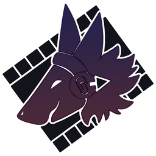

  

<h1 align="center">Clippy</h1>

  OBS-Clips anschauen, schneiden und so exportieren, dass sie unter das Discord-Upload-Limit passen. 
  Windows-Programm, komplett auf Deutsch.

## Was Clippy kann

- **Bibliothek:** alle Clips aus einem oder mehreren Ordnern als Kacheln, mit Vorschau beim Drüberfahren, Favoriten, eigenen Kategorien, Suche und Filtern
- **Schneiden:** Anfang und Ende kürzen, Stellen in der Mitte rausschneiden, mit Zeitleiste und Vorschaubildern
- **Tonspuren einzeln:** jede Spur an/aus, Lautstärke, Stellen stumm schalten oder leiser/lauter machen (mit sanftem Übergang)
- **Export für Discord:** Größe passend zu ohne Nitro / Nitro Basic / Nitro, Auflösung wird automatisch angepasst, Export über die Grafikkarte (NVIDIA/AMD)
- **Drag & Drop:** fertigen Clip direkt aus dem Programm in Discord ziehen oder kopieren und mit Strg+V einfügen
- **Speichern:** Original ersetzen, als Kopie oder unter neuem Namen speichern
- **Design:** eigenes Farbverlauf-Design, Vollbild-Player
- **Updates direkt im Programm**

## Programm herunterladen

1. Rechts auf **Releases** klicken und beim neuesten Release **ClipManager-win-x64.zip** herunterladen.
2. ZIP entpacken, z.B. auf den Desktop oder nach Dokumente (nicht nach "Programme", sonst klappen Updates nicht).
3. `ClipManager.exe` starten. Windows fragt beim ersten Mal evtl. nach ("Windows hat den PC geschützt"): **Weitere Informationen → Trotzdem ausführen**.

Der Ordner `ffmpeg` muss neben der `ClipManager.exe` liegen bleiben. Neue Versionen installierst du danach direkt im Programm: links unten erscheint **Update auf …**.

> Die Datei heißt aus technischen Gründen weiter `ClipManager.exe`, damit der Update-Knopf in älteren Versionen funktioniert.

## OBS-Empfehlung

- Aufnahmeformat **Hybrid MP4** (ab OBS 30) oder **MKV**, Replay-Puffer mit Hotkey.
- Spuren getrennt aufnehmen, z.B. 1 = alles gemischt, 2 = Spiel, 3 = Mikro, 4 = Discord, 5 = Musik. Dann lässt sich in Clippy jede Spur einzeln bearbeiten.

## Stand

| Etappe | Inhalt | Status |
| --- | --- | --- |
| 1 | Grundgerüst, Einstellungen, FFmpeg- und GPU-Erkennung | fertig |
| 2 | Bibliothek mit Kacheln, Vorschaubildern, Favoriten | fertig |
| 3 | Editor: kürzen, Mitte rausschneiden | fertig |
| 4 | Export fürs Discord-Limit, Drag-and-Drop | fertig |
| 5 | Audiospuren einzeln bearbeiten | fertig |
| 6 | Feinschliff (Design, Kategorien, Vollbild …) | großteils fertig |
| 7 | Installer und Ersteinrichtung für andere | offen |

## Credits

Credits to Yippie for the Logo and the Name.

## Für Entwickler

Ausführliche Übergabe für Agents und Entwickler: [CLAUDE.md](CLAUDE.md).

- C# / .NET 8, WPF mit [WPF-UI](https://github.com/lepoco/wpfui), FFmpeg als externes Programm.
- `src/ClipManager.Core`: Logik ohne Oberfläche (läuft auch unter Linux, hat Tests).
- `src/ClipManager`: WPF-Oberfläche (nur Windows).
- Tests: `dotnet test tests/ClipManager.Core.Tests`
